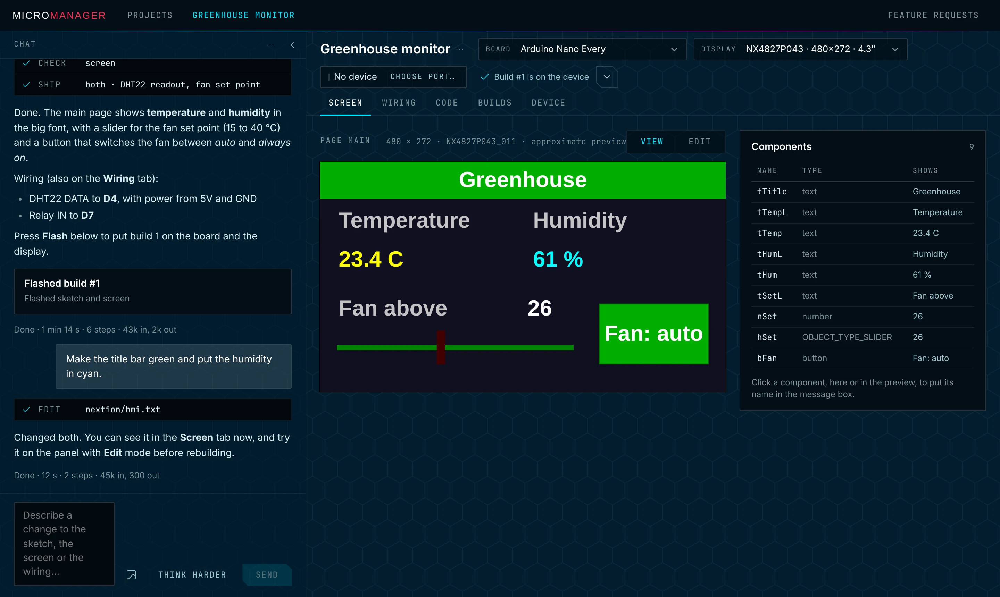
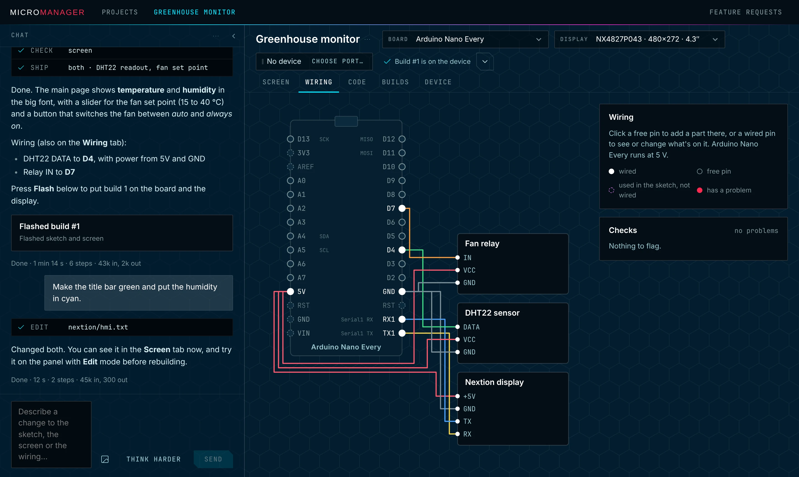
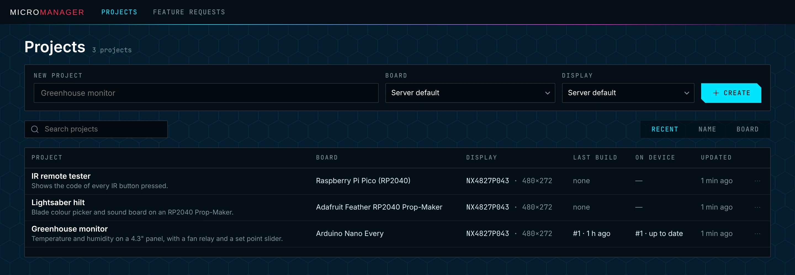

# MicroManager

Build Arduino projects with a [Nextion](https://nextion.tech/) touch display by chatting with an AI.
Describe what you want, and it writes the sketch, lays out the screen, keeps track of the wiring and builds
everything. Then you flash the board and the display straight from your browser.



## What it does

- **Chat to build.** Ask for a change ("show the temperature big, add a fan set point slider") and it edits
  the sketch and the screen, checks the layout, and builds both.
- **Screen preview.** See the display page as it will look, click a component to talk about it, and tune
  positions and colours live on the real panel with **Edit** mode.
- **Wiring.** Every project keeps its wiring. The Wiring tab draws it on the board's pinout and flags
  problems, like a 5 V signal on a 3.3 V pin or a pin the sketch uses but nothing is wired to.
- **Flash from the browser.** One button puts the sketch on the board and the screen on the display over
  USB (Web Serial), on whatever computer the hardware is plugged into.
- **Builds and history.** Every build is kept, so you can see what's on the device and go back.



## Supported hardware

| Boards | Displays |
|---|---|
| Arduino Nano Every<br>Teensy 4.1<br>Raspberry Pi Pico (RP2040)<br>Adafruit Feather RP2040 Prop-Maker<br>ESP32 DevKitC (ESP32-WROOM-32)<br>ESP32-S3 DevKitC-1 | Nextion Basic, Discovery, Enhanced and Intelligent series |

Board-specific flashing notes (Teensy on Linux, RP2040 BOOTSEL, ESP32 BOOT button) are in [docs/FLASHING.md](docs/FLASHING.md).

## What you need

- A computer that runs Docker, for the app itself.
- **A chat backend:** a Claude subscription, or an API key for a Hermes model (see below).
- **A Windows machine or VM with [Nextion Editor](https://nextion.tech/nextion-editor/)**, reachable over SSH.
  The app drives the editor there to compile screens. Without it, everything except screen builds still works.
- **Chrome or Edge** on the computer the hardware plugs into (Web Serial).

## Quick start (Docker)

```bash
docker run -d --name micromanager --restart unless-stopped \
  -p 8765:8765 \
  -v /path/to/micromanager-data:/data \
  -e CLAUDE_CODE_OAUTH_TOKEN='<from `claude setup-token`>' \
  -e VM_HOST='<vm-user>@<vm-ip>' -e VM_USER='<vm-user>' \
  -e VM_JOBROOT='C:\Users\<vm-user>\nxauto' \
  ghcr.io/thomas-nelson23/micromanager:latest
```

1. On first start the container creates an SSH key and prints the public half in its log
   (`docker logs micromanager`). Add it to the Windows machine's authorized keys.
2. Sign in to the Windows desktop as `<vm-user>` and leave it signed in (Nextion Editor runs in that session).
3. Open `http://<docker-host>:8765`, create a project and start chatting.

Browsers only allow USB access on secure pages. Over plain HTTP on your LAN, add the address under
`chrome://flags/#unsafely-treat-insecure-origin-as-secure`, or put the app behind HTTPS. The app has no
login of its own, so don't expose it to the internet without something like Cloudflare Access in front.

Running on Unraid, or want every setting? See [INSTALL-UNRAID.md](INSTALL-UNRAID.md), which also covers the
SSH key setup and troubleshooting in detail.

## Chat: Claude or Hermes

The chat runs on **Claude** by default. Set `CLAUDE_CODE_OAUTH_TOKEN` (made with `claude setup-token`).
Everyday turns use Sonnet, and a message sent with **Think harder** uses Opus.

No Claude? It can run on a **[Hermes](https://nousresearch.com/)** model from Nous Research instead, or on any
model behind an OpenAI-compatible API, with the same tools:

| Setup | Settings |
|---|---|
| OpenRouter (pay per use) | `HERMES_API_KEY=<key from openrouter.ai>` |
| Nous Portal | `HERMES_BASE_URL=https://inference-api.nousresearch.com/v1`, `HERMES_API_KEY=<key>`, `HERMES_MODEL=Hermes-4-70B` |
| Ollama on your own machine | `HERMES_BASE_URL=http://<ollama-host>:11434/v1`, `HERMES_MODEL=hermes3` |

The model must support tool calling. Smaller models make more mistakes than Claude, so expect to point out
more errors. All Hermes settings are listed in [INSTALL-UNRAID.md](INSTALL-UNRAID.md).

## Feedback

Ideas and bug reports are welcome: use the app's **Feature requests** tab (it can open the request as a
GitHub issue here), or [open an issue](../../issues/new?template=feature_request.yml) directly.



## Development

Running from source, the package layout and tests: [docs/DEVELOPMENT.md](docs/DEVELOPMENT.md).
